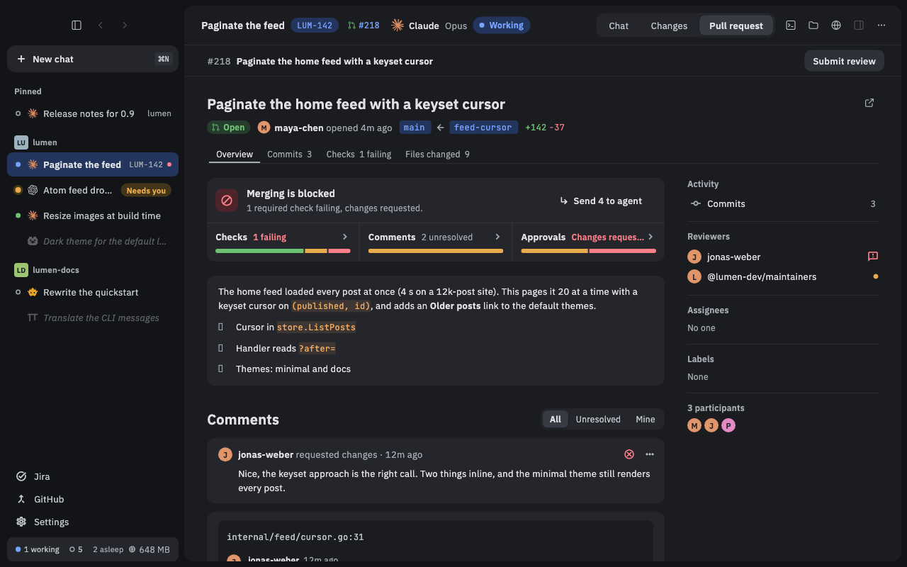

<p align="center"><picture><source media="(prefers-color-scheme: dark)" srcset="docs/brand/mark-dark.svg"></picture></p>

<h1 align="center">Nushi</h1>

<p align="center">A Mac and Linux app that runs your coding agents as chats, beside a diff viewer, your pull requests and your phone.</p>

<p align="center"><a href="#install">Install</a> · <a href="#what-it-does">What it does</a> · <a href="#docs">Docs</a> · <a href="https://github.com/afrase/nushi/releases">Releases</a></p>

<p align="center"></p>

## Install

```sh
brew install --cask afrase/tap/nushi
```

Then open Nushi and set up an agent in **Settings › Agents**. To install from the zip or upgrade or uninstall, see [Installing Nushi](docs/install.md). For Linux's tarball, see [On Linux](docs/install.md#on-linux).

## What it does

<table>
<tr>
<td width="44%"><b>Any ACP agent.</b> Claude, Codex, Ante, oh-my-pi, OpenCode, Pi and PiG run as chats. Nushi talks to them over the <a href="https://agentclientprotocol.com">Agent Client Protocol</a> (ACP). Each agent is your own CLI, with its own login and history, so you can resume a chat in a terminal.</td>
<td><a href="docs/images/agents.png"></a></td>
</tr>
<tr>
<td><b>Changes and review.</b> See the chat's work as a side-by-side or unified diff. Comment on its lines, and the agent gets all your comments in one message.</td>
<td><a href="docs/images/changes.png"></a></td>
</tr>
<tr>
<td><b>Artifacts and previews.</b> When the agent writes Markdown, HTML, images, PDFs, CSVs or Mermaid diagrams, they preview beside the chat and update as it rewrites them. An agent can open a file there itself. Several files open in tabs. To edit a file's source, click and type.</td>
<td><a href="docs/images/preview.png"></a></td>
</tr>
<tr>
<td><b>The Pull request tab.</b> Checks, reviews and threads in one place, with what blocks the merge at the top. One click puts any of them in the agent's message box. Merge from the same tab when it's ready.</td>
<td><a href="docs/images/pull-request.png"></a></td>
</tr>
<tr>
<td><b>Jira.</b> Your issues and sprints as a task list. <b>Start work</b> opens a chat in a worktree (a separate checkout on its own branch) named after the issue.</td>
<td><a href="docs/images/jira.png"></a></td>
</tr>
<tr>
<td><b>Terminals.</b> Shells under each chat. Nushi's background service (the daemon) runs them, so they keep running after you quit the app.</td>
<td><a href="docs/images/terminal.png"></a></td>
</tr>
<tr>
<td><b>The phone.</b> Follow your chats and answer their questions from your phone. It connects through a relay, a small server you run, and the connection is end-to-end encrypted.</td>
<td align="center"><a href="docs/images/phone.png"></a></td>
</tr>
</table>

## Requirements

- A Mac with Apple silicon and macOS 13 or later, or Linux on x86_64 or arm64 with glibc 2.34 or later ([On Linux](docs/install.md#on-linux)).
- An agent's CLI: `claude`, `codex`, `ante`, `omp`, `opencode`, `pi`, `pig` or `agy`. Pi needs Node. Codex needs Node and npm. Claude needs neither, because Nushi runs it through its own built-in agent.

## Docs

- **[The guide](https://github.com/afrase/nushi/wiki)**: how to use Nushi, in short steps. The pages below are the full reference.
- [Installing Nushi](docs/install.md): the zip, Linux's tarball, updates, uninstalling, the daemon and its logs
- [Chats](docs/chats.md): the window, keys, Changes, previews, terminals, worktrees, history, notifications
- [Agents](docs/agent-setup.md): each agent and what Nushi uses of it
- [MCP servers and skills](docs/mcp-and-skills.md)
- [Jira](docs/jira.md) and [GitHub](docs/github.md)
- [Remote access and the phone](docs/remote.md): pairing, and running your own relay
- [Development](docs/development.md): building, testing, and the decisions in [`docs/adr/`](docs/adr/README.md)

Nushi isn't affiliated with Anthropic, OpenAI, or the maker of any agent it runs.

MIT. See [LICENSE](LICENSE).
